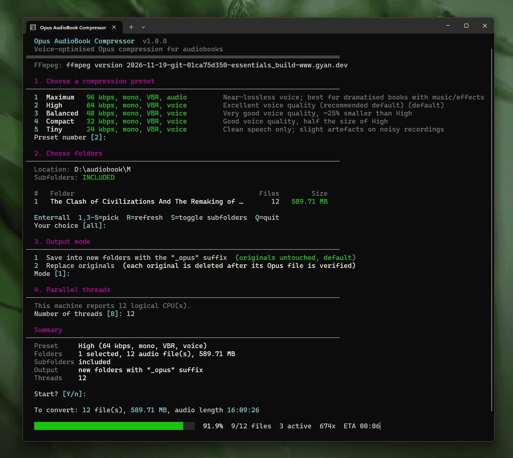

# Opus AudioBook Compressor

**Shrink your audiobook library by 60–90 % without hurting the voice.**
A single-file, dependency-free Python tool that batch-converts MP3 / M4B / M4A / FLAC / WAV and more to speech-optimised **Opus**, keeping tags, cover art and chapters intact.



---

## Why Opus for audiobooks?

Opus is the most efficient lossy codec for speech. At **64 kbps mono** it is generally considered transparent or near-transparent for a spoken voice, while a typical audiobook MP3 is 96–128 kbps (often stereo with identical channels). Lower bitrates (48 / 32 / 24 kbps) still sound good for clean narration and make huge libraries fit on a phone, a player or a cheap server.

This tool replaces paid online converters: it uses the **same encoder** (libopus, the reference implementation) through FFmpeg, exposes the settings those services hide, and runs locally on your files.

## Features

- 🎙️ **Voice-first presets** – 5 ready-made quality levels (96 / 64 / 48 / 32 / 24 kbps, mono, VBR, "voice" tuning). Easy to edit or extend in the script.
- 📁 **Smart folder picker** – detects the folders next to the script, lets you choose `all`, `2`, `1,3-5`, refresh the list, and toggle sub-folder processing (on by default).
- 💾 **Two output modes** – save into `<folder>_opus` (originals untouched, default) or replace originals (deleted only after the new file is verified).
- 🏷️ **Metadata preserved** – tags in any language (Cyrillic, CJK, accents… everything is UTF-8), cover art and chapters (M4B/MKA) are carried over.
- ⚡ **Multi-threaded** – 8 parallel conversions by default, configurable at startup.
- 📊 **Live progress** – colour progress bar with speed (× real-time) and ETA, based on audio duration, not file count.
- 📉 **Size report** – before / after / % saved for every folder (with a sub-folder tree) and for everything together.
- 🔔 **Sound notification** – one beep when everything is done, three beeps if any file failed or an error occurred. On by default, toggle with `B` in the menu or disable with `--no-sound`. No external sound files.
- 🪵 **Clear errors + log file** – human-readable explanations (corrupted file, no disk space, locked file…) and a full log per run in `logs/`.
- 🛡️ **Safe by design** – temp files + atomic rename, output length verification, Ctrl+C cleanup, resume support (already converted files are skipped).
- 🖥️ **Cross-platform** – Windows 10+, Linux, macOS. Works in classic Windows 10 consoles (ANSI colours are enabled automatically; `--ascii` mode available).

## Requirements

| Requirement | Notes |
|---|---|
| **Python 3.8+** | No third-party packages needed. |
| **FFmpeg + FFprobe** with `libopus` | Standard builds include it. Version 5.0+ recommended. |

FFmpeg is looked up in this order: `--ffmpeg` argument → next to the script (`ffmpeg(.exe)`, `ffmpeg/`, `ffmpeg/bin/`) → `PATH`.

### Installing FFmpeg

| OS | Command |
|---|---|
| **Windows** | `winget install Gyan.FFmpeg` – or just run the script: on Windows it can **download FFmpeg automatically** into an `ffmpeg` folder next to it (asks first). |
| **Debian / Ubuntu** | `sudo apt install ffmpeg` |
| **Fedora** | `sudo dnf install ffmpeg` |
| **Arch** | `sudo pacman -S ffmpeg` |
| **macOS** | `brew install ffmpeg` |

## Quick start

1. Download `opus_audiobook_compressor.py`.
2. Put it in the folder that **contains your audiobook folders**:
   ```
   Audiobooks/
   ├── opus_audiobook_compressor.py
   ├── Book One/
   ├── Book Two/
   │   ├── Part 1/
   │   └── Part 2/
   └── Another Book/
   ```
3. Run it:
   ```bash
   python opus_audiobook_compressor.py        # Windows: py opus_audiobook_compressor.py
   ```
4. Answer the prompts – **pressing Enter accepts the default** everywhere:

   | Step | Question | Default |
   |---|---|---|
   | 1 | Compression preset | `2` – High (64 kbps mono) |
   | 2 | Folders (`Enter` all · `1,3-5` · `R` refresh · `S` toggle sub-folders · `B` toggle sound · `Q` quit) | all, sub-folders included, sound on |
   | 3 | Output mode | new `_opus` folders |
   | 4 | Threads | 8 |
   | – | After finishing: start over or exit? | exit |

### Command-line options

| Option | Description |
|---|---|
| `--threads N` | Default thread count (still confirmable in the prompt). |
| `--ffmpeg PATH` | Path to the `ffmpeg` binary or to the folder with `ffmpeg` and `ffprobe`. |
| `--no-sound` | Disable the beep notifications (they can also be toggled with `B` in the folder menu). |
| `--no-color` | Disable colours (also respects the `NO_COLOR` environment variable). |
| `--ascii` | Use plain ASCII instead of box/block characters (for fonts without them). |

## Presets

| # | Name | Bitrate | Mode | Best for |
|---|---|---|---|---|
| 1 | Maximum | 96 kbps | mono, VBR, `audio` | Dramatised books with music / sound effects |
| 2 | **High** *(default)* | 64 kbps | mono, VBR, `voice` | Excellent voice quality – equivalent to the usual "Opus · Voice · VBR · Mono · 64 kbps" |
| 3 | Balanced | 48 kbps | mono, VBR, `voice` | Very good quality, ~25 % smaller |
| 4 | Compact | 32 kbps | mono, VBR, `voice`, 40 ms frames | Clean narration, half the size of High |
| 5 | Tiny | 24 kbps | mono, VBR, `voice`, 60 ms frames | Maximum space saving for clean speech |

### Adding or changing presets

Open the script and edit the `PRESETS` list near the top – no other code needs to change:

```python
PRESETS: List[Preset] = [
    Preset("Maximum",   96, "Near-lossless voice; best for dramatised books", application="audio"),
    Preset("High",      64, "Excellent voice quality (recommended default)"),
    # Your own preset: stereo, 80 kbps, with a gentle high-pass filter
    Preset("My stereo", 80, "Stereo for old radio plays", channels=2,
           extra_args=("-af", "highpass=f=60")),
]
```

| Field | Meaning |
|---|---|
| `name`, `bitrate_kbps`, `description` | Required. Shown in the menu. |
| `application` | `"voip"` (speech tuning, default), `"audio"` (music/general), `"lowdelay"` |
| `channels` | `1` mono (default) or `2` stereo |
| `frame_duration` | libopus frame size in ms (2.5 – 60). Values above 20 only affect the low-bitrate speech modes. |
| `vbr` | `"on"` (default), `"constrained"` or `"off"` (CBR) |
| `compression_level` | 0–10 encoder complexity; `10` = best quality (default) |
| `extra_args` | Any additional raw FFmpeg arguments |

Other global settings you may want to change are at the top of the script: `DEFAULT_THREADS`, `DEFAULT_PRESET_INDEX`, `SOUND_DEFAULT`, `OUTPUT_SUFFIX`, `INCLUDE_SUBDIRS_DEFAULT`, `AUDIO_EXTENSIONS`.

## Output modes

- **Save to `<folder>_opus`** *(default)* – originals are never touched. The folder structure is mirrored, and non-audio files (`cover.jpg`, `.cue`, `.pdf`, files that are already `.opus`) are copied too, so the new folder is a complete audiobook. Re-running skips files that already exist, so an interrupted job can simply be started again.
- **Replace originals** – each `.opus` file is written next to the source; the original is deleted **only after** the new file has been verified (readable, correct duration). Requires typing `YES` to confirm.

> Folders ending with `_opus` are never offered as a source.

## What happens to metadata?

| Item | Handling |
|---|---|
| Text tags (title, author, album, narrator, …) | Copied as Vorbis comments in **UTF-8** – non-English text is preserved as long as the source tags were correct. |
| Cover art | Extracted and embedded as a standard `METADATA_BLOCK_PICTURE` (works in most players). FFmpeg cannot do this on its own for Opus, so the tool does it via a temporary metadata file. |
| Chapters (M4B, MKA, …) | Written as `CHAPTERxxx` tags, which chapter-aware players read. |
| Container leftovers (`major_brand`, …) | Removed. |

> ℹ️ If a source MP3 has legacy tags stored in a local code page (e.g. Windows-1251 in an ID3v2.3 tag declared as Latin-1), they are already garbled *in the source file* and no converter can reliably fix that.

## How it works

1. **Scan** – folders next to the script that contain audio files are listed (hidden folders, `ffmpeg/`, `logs/` and `*_opus` are skipped).
2. **Analyse** – every file is probed with FFprobe (duration, streams, cover art) in parallel.
3. **Convert** – FFmpeg + **libopus** per file, in a thread pool, largest files first for even load balancing:
   `-c:a libopus -b:a 64k -vbr on -application voip -compression_level 10 -ac 1 -ar 48000`
4. **Verify** – the result is probed again; a duration mismatch marks the file as failed and the original is kept.
5. **Report** – sizes before/after per folder (with sub-folders) and in total.

### Why FFmpeg + libopus on every platform?

libopus is the reference Opus encoder and the best one available on all platforms; FFmpeg is the only tool that also reads every audiobook input format (MP3, M4B/AAC, FLAC, WMA, APE, …). Using one engine everywhere gives identical results on Windows, Linux and macOS. Platform-specific work is limited to the parts that really differ: locating/installing FFmpeg, enabling ANSI colours on Windows consoles and path handling.

Notes on the settings:

- **Mono** – spoken audiobooks gain nothing from stereo; mono halves the data to encode, so the same bitrate sounds better.
- **VBR** – gives the best quality per byte; Opus VBR is very well behaved.
- **`voip` application** – enables the encoder's speech-oriented heuristics (this is what "Voice" means in most converters). Use `audio` for music-heavy productions.
- **48 kHz** – Opus always runs at 48 kHz internally; the encoder picks the real audio bandwidth for the bitrate.

## Sound notifications

| Event | Sound |
|---|---|
| All files converted successfully | 1 beep |
| At least one file failed, files were not processed, or an unexpected error occurred | 3 beeps |
| Cancelled with Ctrl+C | silent |

- **Windows:** uses the built-in `winsound` beep (a short tone through the PC speaker/audio device).
- **Linux / macOS:** sends the terminal bell (`BEL`) – make sure the bell is enabled in your terminal's settings.
- Press **`B`** in the folder menu to turn sound on/off (the state is shown as `Sound: ON/OFF` and kept when you start over), or start with `--no-sound`. To change the default, edit `SOUND_DEFAULT` at the top of the script.

## Logs and errors

Every run writes `logs/opus_compressor_YYYYMMDD_HHMMSS.log` (UTF-8) with the settings, FFmpeg version, one line per converted file and the complete FFmpeg output for any failure. On screen you get a short explanation, for example:

```
[FAIL] Part 3/chapter07.mp3: The file is corrupted or is not a valid audio file.
[FAIL] book.m4b: Incomplete MP4/M4B file ('moov' atom missing) - the file is probably truncated.
```

## Troubleshooting

| Problem | Solution |
|---|---|
| *FFmpeg not found* | Install it (see above) or pass `--ffmpeg "C:\path\to\ffmpeg\bin"`. |
| *No libopus encoder* | Use a full FFmpeg build (Gyan.FFmpeg, BtbN builds, distro packages are fine). |
| No beep on Linux/macOS | Enable the terminal bell (audible bell) in your terminal emulator's preferences. |
| Odd characters instead of bars/lines | Run with `--ascii`, or switch the console font to *Consolas* / *Cascadia*. |
| Colours look like `←[96m` | Use Windows 10 1511+ with a modern console, Windows Terminal, or run with `--no-color`. |
| Output is larger than the input | The source bitrate was lower than the preset. Pick a lower preset for such files. |
| Very long Windows paths fail | Enable long paths in Windows or move the books to a shorter path. |
| Cover art missing in some player | A warning is shown if the cover could not be embedded; audio is still converted. |

## Contributing

Issues and pull requests are welcome – especially new presets, platform reports and player-compatibility notes.

## Credits

The code was written using web version of Claude Sonnet 5.5 😁.

## License

[MIT](LICENSE)
FFmpeg and libopus are separate projects with their own licenses; this tool only calls the `ffmpeg` / `ffprobe` executables.
